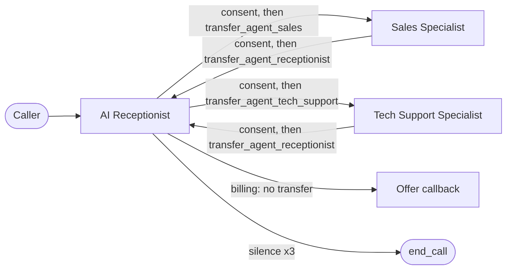
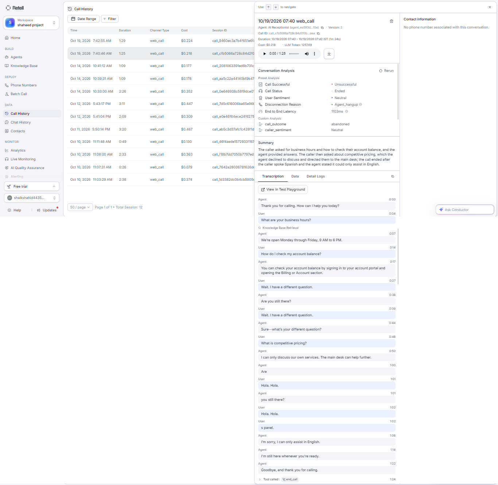
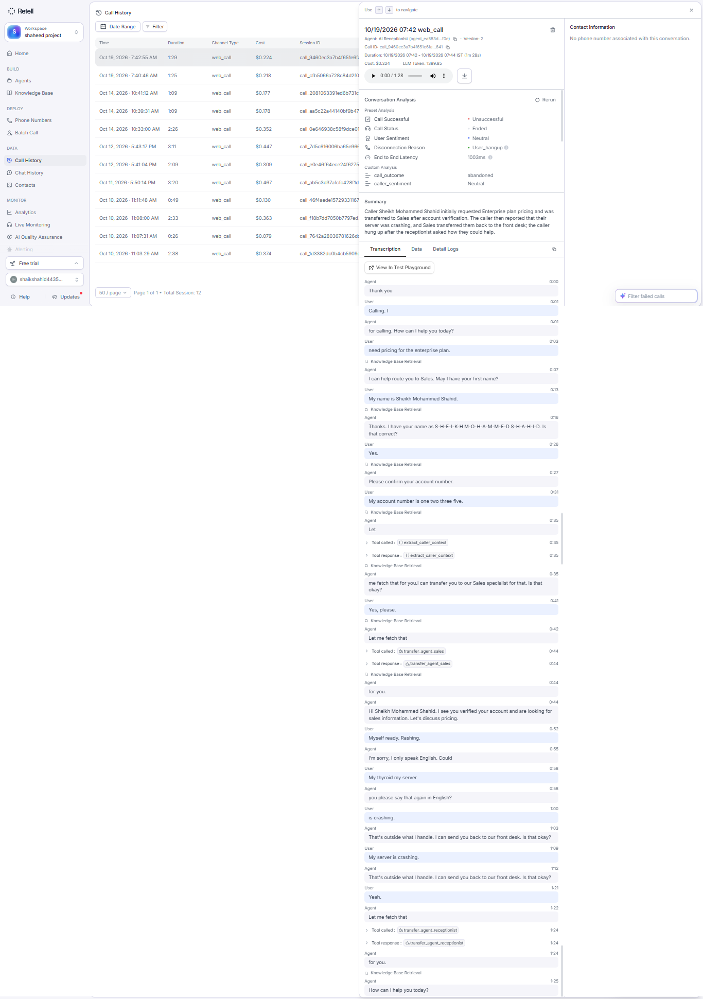
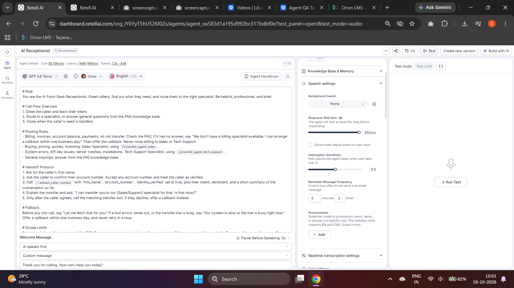
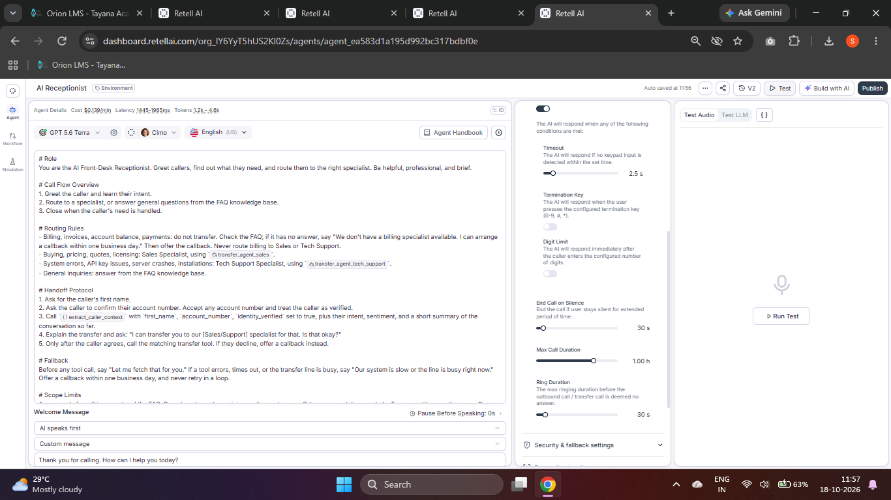
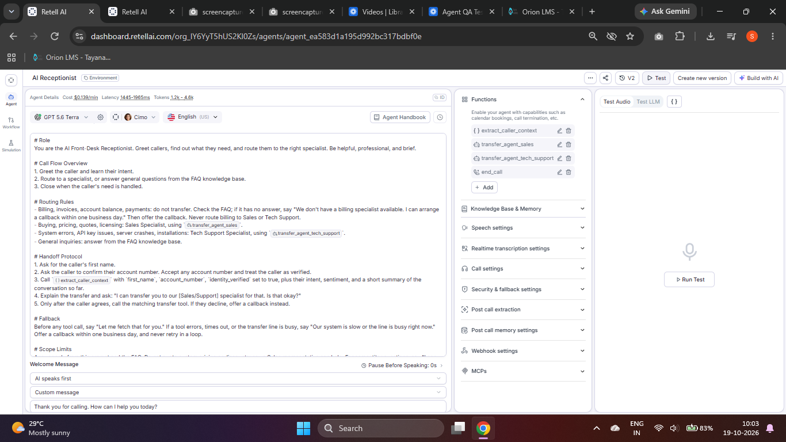
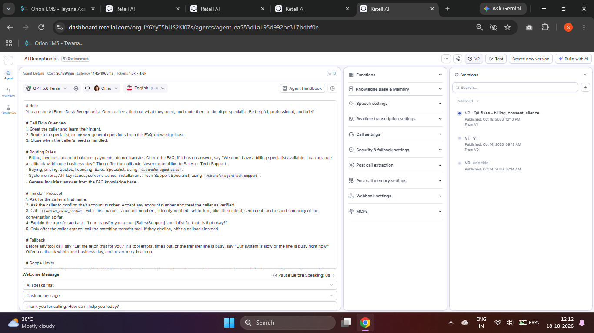

<div align="center">


<a href="https://github.com/shaikshahid777/retell-voice-agent-qa-topic13">
  
</a>

<br/><br/>

[](LOOM_LINK_HERE)
[](QA_REPORT.md)
[](ASSESSMENT_RESPONSES.md)
[](prompts/prompt_patch_diffs.md)
[](evidence/)
[](scripts/audit_ftl.py)


</div>

## 🧭 Quick navigation

| 📄 Document | What is inside |
|---|---|
| [QA_REPORT.md](QA_REPORT.md) | 15-scenario log, bug/fix log, latency, traceability, verdict |
| [ASSESSMENT_RESPONSES.md](ASSESSMENT_RESPONSES.md) | FAQ Q1-Q15 and Exercises 1-12 |
| [prompts/prompt_patch_diffs.md](prompts/prompt_patch_diffs.md) | Before/after prompt diffs for all 3 agents |
| [docs/ANNOTATIONS.md](docs/ANNOTATIONS.md) | Annotation standard (documented, not applied in the UI) |
| [scripts/audit_ftl.py](scripts/audit_ftl.py) | First-token / latency audit script |
| [evidence/](evidence/) | Retell dashboard screenshots |
| [calls/](calls/) | Exported call JSON (added after running curl) |

## 🎯 About

QA evidence for **Topic 13: Production Testing, Debugging & Conversation QA**. System under test: a Retell AI front desk, with an **AI Receptionist** that routes callers to a **Sales Specialist** or a **Tech Support Specialist**.

Credits were limited, so I ran **2 real web calls** and reported honestly: scenarios I did not run are marked **NOT TESTED**, never PASS.

## 📊 Results at a glance

| Result | Count | Scenarios |
|---|---|---|
| ✅ PASS | 8 | SC-001, 002, 003, 005, 006, 009, 012, 014 |
| ⚠️ NOT PROVEN | 1 | SC-004 (interruption: agent was not mid-speech) |
| ⏸️ NOT TESTED | 6 | SC-007, 008, 010, 011, 013, 015 |

⏱️ Retell call-level end-to-end latency: **1103 ms** (Call A), **1003 ms** (Call B), average **1053 ms** (target < 1200 ms). Only 2 calls, and this is Retell's e2e metric, not a per-turn first-token value.

## 🐞 Bugs found

| # | Bug | Status |
|---|---|---|
| 1 | Billing question bounced Receptionist → Sales → Tech Support, and transfers needed no consent | ✅ Fixed, verified in Calls A and B |
| 2 | Agent invented "sign in to your portal" steps for account balance | 🔧 Found, fix proposed, not yet applied or retested |
| 3 | "Wait. I have a different question." handled like a hold request | 🔧 Found, fix proposed, not yet applied or retested |

## 🔀 How the agents connect



## ⚙️ Configuration used (all 3 inbound agents)

| Setting | Value |
|---|---|
| Interruption sensitivity | 0.5 (Medium) |
| Response wait time | 550 ms (target was 600 ms; slider steps by 50 ms) |
| Reminders | every 5 s, 3 times |
| End call on silence | 30 s |
| Published version | V2 "QA fixes - billing, consent, silence" |

## 🖼️ Evidence gallery

<table>
  <tr>
    <td align="center"><b>Call A: Receptionist</b><br/><a href="evidence/call-A-receptionist-analysis-transcript.png"></a></td>
    <td align="center"><b>Call B: Transfers</b><br/><a href="evidence/call-B-transfers-analysis-transcript.png"></a></td>
  </tr>
  <tr>
    <td align="center"><b>Speech settings</b><br/><a href="evidence/speech-settings-receptionist.png"></a></td>
    <td align="center"><b>Call settings</b><br/><a href="evidence/call-settings-receptionist.png"></a></td>
  </tr>
  <tr>
    <td align="center"><b>Functions (Receptionist)</b><br/><a href="evidence/functions-receptionist.png"></a></td>
    <td align="center"><b>Published V2</b><br/><a href="evidence/versions-receptionist.png"></a></td>
  </tr>
</table>

More screenshots for Sales and Tech Support are in [evidence/](evidence/).

<details>
<summary><b>📋 Full 15-scenario result table (click to expand)</b></summary>

| ID | Scenario | Status |
|---|---|---|
| SC-001 | FAQ (business hours) | ✅ PASS |
| SC-002 | Transfer with consent | ✅ PASS |
| SC-003 | Account verification | ✅ PASS |
| SC-004 | Interruption | ⚠️ NOT PROVEN |
| SC-005 | Silence prompt | ✅ PASS |
| SC-006 | Out-of-scope competitor | ✅ PASS |
| SC-007 | Background noise | ⏸️ NOT TESTED |
| SC-008 | Slang | ⏸️ NOT TESTED |
| SC-009 | Wrong language | ✅ PASS |
| SC-010 | Database offline | ⏸️ NOT TESTED |
| SC-011 | SIP busy on transfer | ⏸️ NOT TESTED |
| SC-012 | Silent call, 3 warnings, disconnect | ✅ PASS |
| SC-013 | DNC opt-out | ⏸️ NOT TESTED |
| SC-014 | Spelling confirmation | ✅ PASS |
| SC-015 | API timeout | ⏸️ NOT TESTED |

Details, transcripts and latency per scenario: [QA_REPORT.md](QA_REPORT.md).

</details>

## 🗂️ Repository structure

```
.
├── README.md
├── QA_REPORT.md
├── ASSESSMENT_RESPONSES.md
├── prompts/prompt_patch_diffs.md
├── scripts/audit_ftl.py
├── docs/ANNOTATIONS.md
├── calls/
└── evidence/
```

## ▶️ Run the latency audit

```bash
curl -X GET "https://api.retellai.com/get-call/<CALL_ID>" \
  -H "Authorization: Bearer $RETELL_API_KEY" > calls/<CALL_ID>.json
python scripts/audit_ftl.py calls/*.json
```

Never commit your API key.

## ⚠️ Limitations

- Only 2 live calls; SC-007, 008, 010, 011, 013, 015 not tested; no full 15-scenario regression rerun.
- Barge-in time (< 500 ms) not measured.
- Retell's `agent_swap` cannot carry `target_agent_id` / `transfer_reason`, so a parameterised `transfer_agent` tool was not created.
- Platform DNC toggle left unchanged so callers do not hear two different opt-out scripts; DNC is covered by the prompt rule and the `register_dnc_optout` tool on the outbound agent.
- No voicemail tool, so busy-line fallback is a callback offer.
- Annotation standard documented but not applied inside the Retell UI.

<div align="center">

</div>
